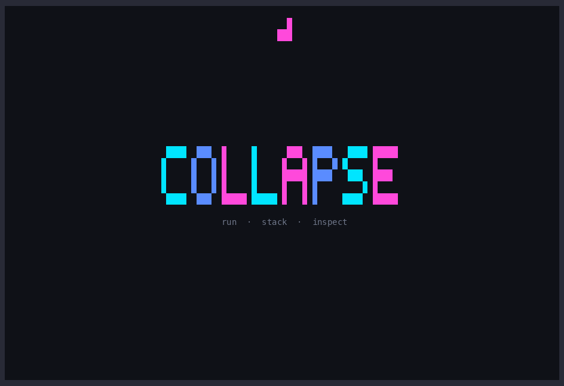

# collapse

`collapse` turns a sequence of shell commandns into an organized, reviewable workflow. Edit and reorder
commands before running, decide which steps are required, and inspect each result in its own searchable tab.

I whipped this up while working on a complex project that required me to daisy chain a bunch of commands frequently, and I wanted to inspect the previous commands' logs to determine the failure downstream.

```text
                         █
                       ███

 ████  ███  █     █      ███  ████   ████ █████
█     █   █ █     █     █   █ █   █ █     █
█     █   █ █     █     █████ ████   ███  ████
█     █   █ █     █     █   █ █         █ █
 ████  ███  █████ █████ █   █ █     ████  █████
```

## Demo



Reproduce the demo end to end with [`scripts/record-demo.sh`](scripts/record-demo.sh). It stages deterministic commands under `/tmp/collapse-demo`, drives the TUI, records the cast, and regenerates this GIF without including personal environment data.

```sh
scripts/record-demo.sh
```

```sh
collapse 'cargo test' 'cargo clippy --all-targets' 'cargo build --release'
```

Every invocation opens a command editor before anything runs. Review, add, remove, edit, or reorder commands, then explicitly confirm the queue. Running `collapse` without arguments opens an empty editor.

Once confirmed, `collapse` runs every command in an isolated pseudo-terminal, captures its output, and gives it a dedicated tab. Terminal-aware programs therefore retain spinners, in-place progress bars, and color detection. ANSI styling is translated into Ratatui styles, including 16-color, 256-color, and 24-bit truecolor output. Press `/` to search the selected task's output with Vim-style match navigation.

## Install

The recommended installation method downloads a prebuilt release binary:

```sh
cargo binstall collapse-rs
```

Install [`cargo-binstall`](https://github.com/cargo-bins/cargo-binstall) first if the Cargo subcommand is not available. To compile from source instead:

```sh
cargo install collapse-rs --locked
```

For local development:

```sh
cargo install --path .
```

All methods install the `collapse` executable.

## Usage

```text
collapse [--color always|auto|never] [COMMAND]...
```

Each quoted argument is one shell command. Commands containing arguments, pipelines, or redirects should remain inside one quoted string.

```sh
collapse 'cargo fmt --check' 'cargo test' 'cargo clippy -- -D warnings'
collapse 'npm run lint' 'npm test' 'npm run build'
collapse --color auto 'git status' 'git log --oneline --decorate -20'
collapse
```

Color output is forced by default for consistent styling across tools. Tools with their own color policy may still need an explicit flag such as `--color=always`.

Commands are required by default. If a required command fails, the remaining queue is marked skipped. Press `Space` in the editor to make a command optional; optional failures are shown as warnings, do not stop the queue, and do not make the overall run fail. Commands are non-interactive: `collapse` owns terminal input for navigation and gives child commands an empty stdin.

## Command editor keys

| Key                  | Action                               |
| -------------------- | ------------------------------------ |
| `Space`              | Toggle required/optional             |
| `Enter`, `e`         | Edit the selected command            |
| `a`, `o`             | Add and edit a command               |
| `d`, `Delete`        | Delete the selected command          |
| `Up`/`Down`, `j`/`k` | Select a command                     |
| `J` / `K`            | Move the selected command down/up    |
| `r`                  | Review and confirm the command queue |
| `q`, `Esc`           | Open the quit confirmation           |

While editing, use `Enter` to save, `Esc` to cancel, arrow keys to move the cursor, and `Ctrl+U` to clear the line.

## Output viewer keys

| Key                      | Action                                           |
| ------------------------ | ------------------------------------------------ |
| `Tab`, `Right`, `l`      | Next command                                     |
| `Shift-Tab`, `Left`, `h` | Previous command                                 |
| `Up`/`Down`, `j`/`k`     | Scroll output                                    |
| `PageUp`/`PageDown`      | Scroll by a page                                 |
| `Home`, `g`              | Jump to the top                                  |
| `End`, `G`               | Jump to the end and follow new output            |
| `/`                      | Enter a literal, case-sensitive search           |
| `n` / `N`                | Jump to the next/previous match                  |
| `Esc`                    | Cancel search, clear search, or confirm quitting |
| `q`                      | Open quit confirmation                           |
| `y`                      | Confirm quitting and cancel remaining commands   |
| `n`, `Esc`, `Enter`      | Dismiss quit confirmation                        |

`collapse` exits with status 1 if a required command fails and 130 if execution is cancelled. Optional failures do not change the exit status.

## Development

See [CONTRIBUTING.md](CONTRIBUTING.md) for local hooks, Conventional Commits, quality checks, and the release process.
